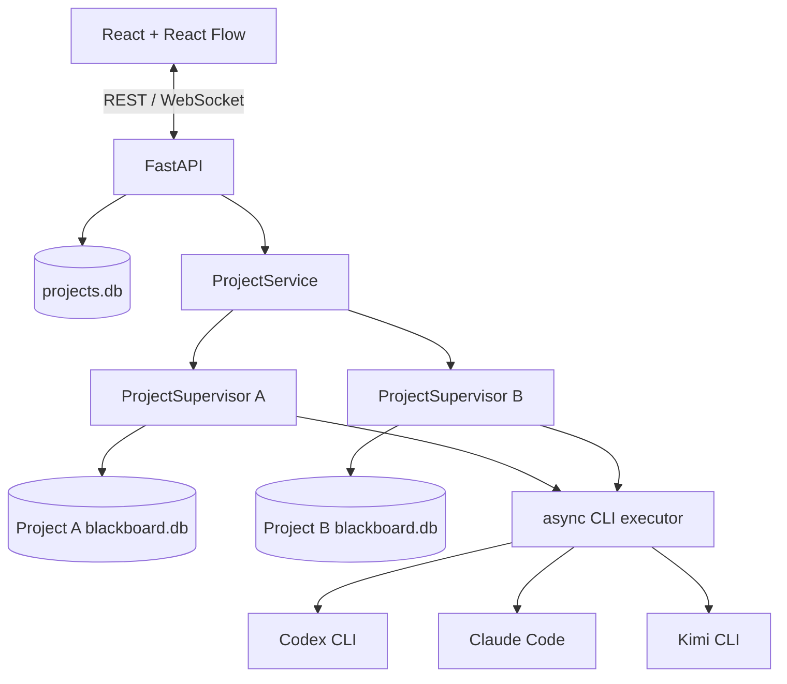

# Web 多 CLI Agent 黑板协作平台

一个运行在 localhost 的多 Agent 协作工具。每个项目拥有独立的图黑板、SQLite 数据库、Agent Supervisor、执行目录和实时事件频道。Codex CLI、Claude Code、Kimi CLI 等 provider 可以在同一项目内异步工作，不同项目也可以并发运行。

Web 工作区使用节点表示 `Goal`、`Origin`、`Fact` 和 `Hint`，使用第一类边表示 `Intent`。每条 Intent 可以包含多个独立 Agent execution；stdout、stderr、退出状态和工作目录均保留并可在页面中查看。

## 主要能力

- 创建“仅黑板”或“立即启动 Agent”项目。
- 在项目创建时选择 provider 和项目内最大 Agent 并发数。
- 使用 React Flow 浏览、拖动、创建和连接图元素。
- 将 Intent 建模为边，不再创建 Intent 节点。
- 同一 Intent 合并语义边，同时保留各 provider 的独立 execution 和日志。
- 通过项目级 WebSocket 实时接收图事件和 stdout/stderr 分块。
- 从 Fact 追溯 producing Intent、execution 和 provider。
- 持久化 Planning Attempt、调度等待、健康检查、熔断、恢复和执行指标。
- 分页读取受大小与保留策略约束的日志，并导出二次脱敏的项目审计包。
- 从全局运行面板查看配额、排队任务、活动任务和 provider 健康状态。
- 在项目诊断侧栏筛选规划/执行记录、查看日志、人工重试和受控重新打开项目。
- 同时运行多个相互隔离的项目。
- 通过 FastAPI 提供 REST、WebSocket 和生产前端静态资源。

## 架构



每个启用的 provider 在项目 Supervisor 下运行独立循环：

1. 读取当前图快照。
2. 输出 `BLACKBOARD_INTENT`，登记或复用 Intent 边。
3. 创建独立 execution 并执行该 Intent。
4. 流式保存和发布 stdout/stderr。
5. 输出 `BLACKBOARD_RESULT`，事务性合并 Fact、普通关系和最终答案声明。
6. 没有可继续工作的内容时进入 idle，收到图更新后再次观察。

项目不使用全局轮次屏障。`generation` 只表示图中的因果层次：初始节点为 G0，从 generation N 节点创建的 Intent 及其 Fact 输出为 G(N+1)。

## 图模型

| 元素 | 表示方式 | 创建者 | 说明 |
| --- | --- | --- | --- |
| `Goal` | 节点 | 人类 | 项目目标 |
| `Origin` | 节点 | 人类 | 初始条件和题面 |
| `Fact` | 节点 | 人类或 Agent | 可追溯到来源和 producing execution |
| `Hint` | 节点 | 人类 | 对 Agent 的正式图内提示 |
| `Intent` | 边 | 人类或 Agent | 从已知节点推进到目标节点的行动 |
| 普通关系 | 边 | 人类或 Agent | `supports`、`contradicts`、`derived_from` 等 |

Agent 只能在结果阶段创建 Fact 和普通关系，不能创建或修改 Goal、Origin、Hint，也不能绕过规划阶段创建另一个 Intent。

## 项目隔离

默认数据位于 `web-data/`：

```text
web-data/
  projects.db
  projects/
    <project-id>/
      blackboard.db
      layout.json
      executions/
        plan-<provider>-<id>/
          stdout.txt
          stderr.txt
        run-<provider>-<id>/
          stdout.txt
          stderr.txt
      audit-exports/
        audit-<timestamp>-<id>.zip
```

- 每个项目使用独立 SQLite 和目录。
- 每个项目使用独立 Supervisor、取消令牌和 WebSocket 频道。
- 项目 Blackboard 中的 `projects.status` 是运行状态的权威来源；全局
  `projects.db` 只保存列表索引缓存，并由 `ProjectService` 在生命周期变更和
  读取时同步。
- execution 查询同时校验 `project_id` 与 `execution_id`。
- 停止一个项目不会终止其他项目的 CLI 进程。
- `challenge_path` 是用户显式选择的外部只读上下文路径。

## 环境要求

- Python 3.10 或更高版本。
- Node.js 20.19+ 或 22.12+。
- 至少一个已安装并完成认证的 CLI provider。
- Windows、macOS 或 Linux。

## 安装与启动

```powershell
python -m pip install -r requirements.txt
cd frontend
npm install
npm run build
cd ..
python web_main.py
```

打开 [http://127.0.0.1:8000](http://127.0.0.1:8000)。服务只监听 localhost。

生产入口默认读取：

- 数据目录：`web-data/`
- provider 配置：`worker/providers.json`

可以使用环境变量覆盖：

```powershell
$env:BLACKBOARD_DATA_ROOT = 'E:\blackboard-data'
$env:BLACKBOARD_PROVIDER_CONFIG = 'E:\configs\providers.json'
python web_main.py
```

## 开发模式

先启动后端：

```powershell
python web_main.py
```

再启动 Vite：

```powershell
cd frontend
npm run dev
```

Vite 默认地址为 `http://127.0.0.1:5173`，并将 `/api` 和 `/ws` 代理到 `127.0.0.1:8000`。

## 项目模式

### 仅黑板

项目创建后保持 idle。用户可以先添加 Fact、Hint 和 Intent，调整布局并检查图，再点击“启动 Agent”。创建时选择的 provider 会保留，供以后启动使用。

### 立即启动 Agent

创建项目后立即启动所选 provider。每个 provider 异步规划和执行，页面实时显示项目状态、Intent execution 和日志。

## Provider 配置

默认配置文件是 `worker/providers.json`：

```json
{
  "coordinator": {
    "max_global_running": 16,
    "max_project_running": 4,
    "max_global_planning": 4,
    "max_project_planning": 2,
    "aging_seconds": 30
  },
  "audit": {
    "max_log_bytes": 8388608,
    "max_retained_log_sets": 500,
    "max_retained_exports": 5,
    "default_log_page_bytes": 262144,
    "max_log_page_bytes": 1048576
  },
  "providers": [
    {
      "name": "codex",
      "enabled": true,
      "priority": 100,
      "max_running": 4,
      "command": [
        "codex",
        "exec",
        "--dangerously-bypass-approvals-and-sandbox",
        "-C",
        "{work_dir}",
        "-"
      ],
      "health_check": {
        "command": ["codex", "--version"],
        "timeout_seconds": 10,
        "cooldown_seconds": 15,
        "max_cooldown_seconds": 300,
        "failure_threshold": 3
      },
      "planning_timeout_seconds": 120,
      "timeout_seconds": 900
    }
  ]
}
```

字段说明：

| 字段 | 说明 |
| --- | --- |
| `name` | provider 名称和执行目录标识 |
| `enabled` | 是否可被项目选择 |
| `priority` | 同一项目许可队列中的基础优先级；不参与事实可信度判断 |
| `max_running` | 该 provider 跨项目同时占用的最大许可数；默认 4 |
| `command` | 参数数组；不经过 shell 解释 |
| `health_check.command` | 可选启动前探测命令；不接收 prompt 或路径占位符 |
| `health_check.timeout_seconds` | 单次健康探测超时 |
| `health_check.cooldown_seconds` | 临时故障的首次冷却时间 |
| `health_check.max_cooldown_seconds` | 指数退避的冷却上限 |
| `health_check.failure_threshold` | 连续失败达到该值后将项目标记为 `degraded` |
| `planning_timeout_seconds` | 规划调用超时；省略时取 `timeout_seconds` 与 120 秒中的较小值 |
| `timeout_seconds` | Intent 执行调用超时 |

支持 `{work_dir}` 和 `{challenge_dir}` 占位符。prompt 通过 stdin 发送，CLI 认证由各 provider 自己管理，平台不读取或保存 API Key。

### 执行配额与公平调度

Web 服务中的项目共享一个 `ExecutionCoordinator`。它只决定外部 CLI 调用何时
获得运行许可，不读取图内容、不生成 Intent，也不改变各 provider 的独立规划：

| 字段 | 说明 |
| --- | --- |
| `coordinator.max_global_running` | 全部项目合计的规划和执行调用上限；默认 16 |
| `coordinator.max_project_running` | 单项目规划和执行调用上限；默认 4 |
| `coordinator.max_global_planning` | 全部项目合计的规划调用上限；默认 4 |
| `coordinator.max_project_planning` | 单项目规划调用上限；默认 2 |
| `coordinator.aging_seconds` | 排队每经过该秒数增加一个有效优先级；默认 30 |

- 规划和 Intent execution 分别计数；规划上限为 execution 保留可用容量。
- 项目之间按轮转顺序获得许可，同一项目达到上限后会让出全局容量。
- 同一项目内先比较 provider `priority`，再叠加等待 aging；低优先级请求不会
  因持续到达的高优先级请求而永久饥饿。
- `missing`、`auth_failed`、`unhealthy` 或仍在 cooldown 的 provider 不进入
  许可队列。项目停止或任务取消时，排队请求会移除，已获得的许可会在退出路径释放。
- 省略 `coordinator` 或 `max_running` 时使用上述兼容默认值；所有配额必须为
  正整数，项目配额不能高于全局配额。

### Provider 健康状态

项目启动前会执行已配置的健康探测，并将结果保存到项目 Blackboard 的
`provider_health` 表。状态包括 `healthy`、`unhealthy`、`auth_failed`、
`missing`、`cooldown` 和 `unknown`：

- `missing`、`auth_failed` 和 `unhealthy` 会停止当前 provider 循环，但不阻塞
  其他 provider。
- 超时、网络错误、5xx 和进程异常进入有上限的指数冷却；冷却到期后先执行
  半开健康探测，再允许一次实际调用。图更新不能绕过 `cooldown_until`。
- 401、403 或明确未登录会进入 `auth_failed`，只有用户再次启动项目才会重新
  探测，不会自动消耗调用额度。
- 协议错误仍只执行一次同 Intent 纠错，不计入 provider 连续健康失败。
- 健康错误写入数据库和事件前会截断并脱敏；确认认证失败后，该次 stdout 和
  stderr 文件会替换为固定摘要，不保留 Token 或完整认证响应。

`GET /api/projects/{project_id}/providers` 返回持久化健康状态；项目详情和图快照
也包含 `provider_health`。状态变化以 `provider.health_changed` 事件写入项目
事件流，可通过 WebSocket 的 `after` 参数回放。未配置 `health_check` 的自定义
provider 保持兼容，启动时显示 `unknown`，首次完整调用成功后变为 `healthy`。

### 审计与日志

每次规划都会创建独立的 Planning Attempt，保存 provider、快照 sequence、排队与
执行时间、stdout/stderr 路径、工作目录、最终判定原因和产生的 Intent。判定状态
包括 `valid`、`idle`、`stale`、`protocol_error`、取消和 provider 进程状态。
Execution 另行保存重试编号、取消原因、调度等待原因、模型、CLI 版本与 token
用量；无法从 CLI 获得的字段明确保存为 `unknown`。

| 字段 | 说明 |
| --- | --- |
| `audit.max_log_bytes` | 每次调用的单个 stdout 或 stderr 文件上限；默认 8 MiB |
| `audit.max_retained_log_sets` | 每个项目保留的已结束规划/执行日志组总数；默认 500 |
| `audit.max_retained_exports` | 每个项目保留的审计 ZIP 数量；默认 5 |
| `audit.default_log_page_bytes` | 日志接口默认单流页大小；默认 256 KiB |
| `audit.max_log_page_bytes` | 日志接口允许的单流页大小上限；默认 1 MiB |

日志在写盘和 WebSocket 推送前脱敏；读取接口保留原有 `stdout`、`stderr` 字段，
同时返回字节偏移、总大小和是否还有下一页。超过保留数量的旧日志文件会删除，
数据库记录保留并标记 `logs_retained=false`。命令参数和环境变量不写入审计表或
导出文件。

审计接口：

- `GET /api/projects/{project_id}/planning-attempts`
- `GET /api/projects/{project_id}/planning-attempts/{attempt_id}`
- `GET /api/projects/{project_id}/planning-attempts/{attempt_id}/logs`
- `GET /api/projects/{project_id}/executions`
- `GET /api/projects/{project_id}/executions/{execution_id}/logs`
- `GET /api/projects/{project_id}/audit/export`

日志接口接受 `stdout_offset`、`stderr_offset` 和 `limit` 查询参数。审计 ZIP 包含图
快照、Planning Attempt、Execution、provider 健康、事件流和仍被保留的日志；
结构化数据与日志在写入 ZIP 前会再次脱敏。

### Web 操作与诊断

项目总览通过 `GET /api/runtime` 展示全局、单项目与规划配额，以及当前活动任务、
等待队列和各项目 provider 健康状态。页面每 3 秒刷新一次；它只读取运行状态，
不会自动启动项目、重试调用或恢复外部 CLI。

工作区“诊断”侧栏提供 Execution 与 Planning Attempt 两个视图，可按 provider、
状态和时间过滤。选择记录后复用底部日志面板读取持久日志；Planning Attempt 可
定位到其产生的 Intent。`interrupted`、`auth_failed`、`cooldown`、协议错误和
超时均使用独立状态文案。服务重启恢复过项目时，工作区会显示被中断的规划与
执行数量。

人工操作：

- `POST /api/projects/{project_id}/executions/{execution_id}/retry` 只由用户点击
  触发。它先创建新的 Execution，使用 `retry_of_execution_id` 关联来源记录，
  不覆盖原状态、日志或产出；活动 Execution 和已完成但尚未重新打开的项目不能重试。
- `POST /api/projects/{project_id}/reopen` 仅接受 `achieved` 项目。它递增
  `goal_version`、清除当前展示的最终答案并恢复为 `idle`；旧答案和完整审计历史
  仍保留，但不会参与新版本共识。重新打开不会自动启动 Agent。
- 审计下载按钮显式调用现有 ZIP 导出接口。停止、重试、重新打开和启动均需要
  用户操作，不会由状态轮询自动触发。

## Agent 协议

规划阶段最后输出：

```text
BLACKBOARD_INTENT: {"action":"plan","source_node_id":"fact-...","target_node_id":"goal-...","content":"Verify the key"}
```

没有合理工作时输出：

```text
BLACKBOARD_INTENT: {"action":"idle","reason":"No unresolved work"}
```

执行阶段必须输出单行严格 JSON。`facts` 和 `edges` 的成员都是对象，不是字符串或二维数组：

```text
BLACKBOARD_RESULT: {"intent_id":"intent-...","facts":[{"ref":"flag-fact","content":"flag = flag{example}"}],"edges":[{"type":"supports","from":"flag-fact","to":"goal-..."}],"goal_achieved":true,"final_answer":"flag{example}"}
```

`facts` 项只能包含 `ref`、`content`；`edges` 项只能包含 `type`、`from`、`to`。结构化结果整份校验并在单个事务中合并。协议错误不会留下部分 Fact 或关系，原始 stdout/stderr 仍会保留。

执行进程成功但协议解析失败时，Supervisor 会保留失败 execution，并针对同一 Intent 创建一次带解析错误反馈的纠错 execution。第二次仍失败才把本轮计为失败。

## 实验与效果评估

`experiments/` 提供与生产 `BlackboardStore`、`ProjectSupervisor`、Intent-Execution
协议和共享调度器相连的可重复实验 Runner，不使用另一套纯模拟状态机。默认配置只
运行 deterministic fake providers：

```powershell
python -m experiments `
  --config experiments/configs/deterministic_smoke.json `
  --output experiments/results/deterministic-smoke-v1-20260730
```

默认套件对每个条件使用相同的四项任务、Prompt、24 次模型调用上限、5 秒超时和
随机种子，并重复三次；最多三个项目共享同一个 `ExecutionCoordinator` 并发运行。
七个条件为：

| 条件 | 调度与策略 |
| --- | --- |
| `single_agent_serial` | 单 Agent 串行规划与执行 |
| `fixed_roles` | 固定 Planner 与 Executor，串行交接 |
| `round_robin` | 多 Agent 按固定轮询顺序串行运行 |
| `role_free_async` | 当前无角色异步协作方案 |
| `no_stale_check` | 关闭两次 stale-plan 检查 |
| `no_protocol_correction` | 协议错误后不创建纠错 Execution |
| `single_execution_per_intent` | 每个 Intent 最多保留一次 Execution |

每次运行保存 `blackboard.db`、完整事件、Planning/Execution 原始日志、图快照和
`result.json`。套件根目录保存规范化配置、环境与源码 SHA-256、随机种子、
`raw_results.jsonl`、`summary.json` 和当次分析脚本副本。可以从原始结果重新分析：

```powershell
python -m experiments.analyze experiments/results/deterministic-smoke-v1-20260730
```

采集指标包括任务成功率、规则判定的答案正确率、总耗时、首个 Fact/达到目标时间、
实际模型调用和统一预算、可获得的 token 与估算成本、重复 Intent、无效 Execution、
协议错误、stale plan、provider 恢复时间、故障后剩余任务完成率、吞吐量和并发项目
Jain 公平指数。答案一致性仅保留为提议数量、唯一答案数和最大一致组等信号，正确性
由任务的 `expected_answer` 规则独立判定。

真实 CLI 模式不会被默认命令触发。只有配置显式设置 `"mode": "real"`，同时提供
provider 配置并传入费用授权开关时才会运行：

```powershell
python -m experiments `
  --config E:\experiment\real-suite.json `
  --provider-config worker/providers.json `
  --allow-real-providers `
  --output E:\experiment\results\real-run-01
```

2026-07-30 的默认 fake 套件完成 84 个运行，`runner_errors=0`，并保留 84 份
SQLite。四个对照/当前条件与 stale 消融均为 12/12；关闭协议纠错为 9/12，单
Intent 一次 Execution 为 6/12，失败集中在专门要求纠错或失败后重试的夹具。
这只能证明实验框架可重复执行、消融约束生效且工程指标可采集，不能证明无角色
异步方案在真实模型上的质量或效率优势。

## CLI 入口

现有 CLI 入口继续使用同一套 Intent-edge 运行时：

```powershell
python main.py --goal "Recover the flag" --origin "Challenge statement" --challenge E:\ctf\challenge
```

## 测试

后端测试：

```powershell
python -m unittest discover -s tests -v
python -m compileall main.py web_main.py orchestrator worker web tests
```

前端单元测试和构建：

```powershell
cd frontend
npm test -- --run
npm run build
```

2026-07-30 当前实测：后端 `125/125`、前端 `21/21`、Playwright E2E `8/8`，
生产构建成功。

Playwright E2E 首次运行前安装浏览器：

```powershell
npx playwright install chromium
npm run test:e2e
```

E2E 使用本地 fake providers，不调用真实模型，不消耗模型额度。测试覆盖桌面
`1440x900`、窄屏 `390x844`、多项目隔离、人工建图后启动、运行总览、规划/执行
诊断、Intent 跳转、审计入口、真实日志文件和 WebSocket 更新。测试端口可通过
`BLACKBOARD_E2E_API_PORT` 与 `BLACKBOARD_E2E_WEB_PORT` 调整。

## 安全与授权

本项目可用于 CTF、安全评估、漏洞研究和渗透测试相关任务，但只能在明确获得授权的环境中使用。不要对未经所有者许可的系统、网络、应用或数据运行自动化安全测试。

工作目录隔离不等同于容器级安全隔离。默认 Codex 和 Claude 配置会关闭 CLI 自身的审批与沙箱，只适合在外部隔离的虚拟机或容器中运行。CLI 的实际文件、网络和进程权限取决于操作系统账户以及虚拟机或容器的边界；不要在含有宿主机共享目录、生产凭据或未隔离局域网访问的环境中使用默认配置。

## 当前限制

- 这是本机单进程调度平台，不是分布式任务系统。
- 第一版没有登录、组织、共享或多用户并发编辑。
- 服务重启后首次打开项目时，会把遗留的 `queued`/`running` Planning Attempt
  和 `planned`/`running` execution 幂等标记为 `interrupted`，记录
  `server restarted` 事件，并把遗留的
  `running` 项目恢复为 `idle`。恢复事件可通过 WebSocket `after` 参数重放；
  外部 CLI 不会自动重启，必须由用户再次启动项目。
- 最终答案共识使用规范化后的精确文本，不自动向 CTF 平台提交答案。
- 相似 Fact 不自动合并，只保守地保留独立命题和关系。

## 来源与致谢

本项目的黑板协作思想学习自 [oritera/Cairn](https://github.com/oritera/Cairn)。经与 Cairn 作者沟通并获得允许后，本项目结合多 CLI Agent、SQLite、FastAPI 和本地 Web 图工作区进行了独立设计和实现。本项目不是 Cairn 的分支、兼容实现或官方项目，也不复制 Cairn 源码。
