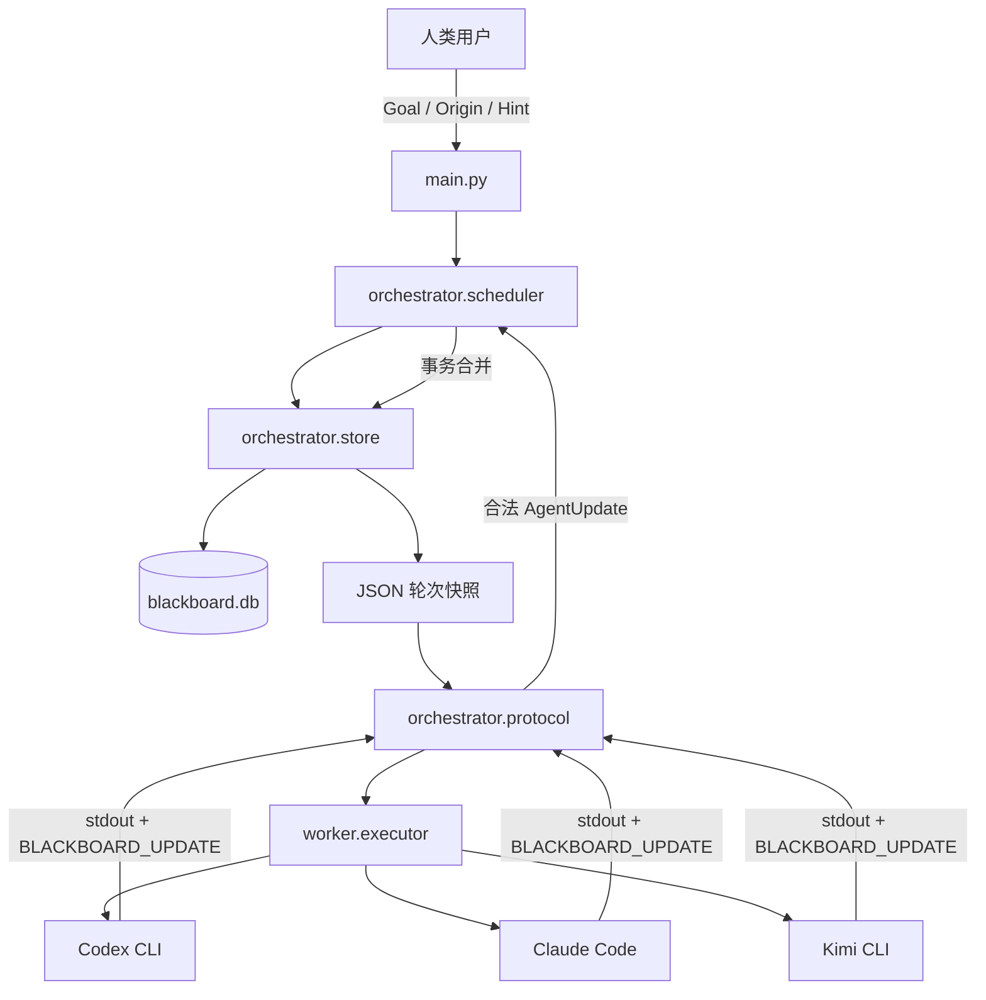
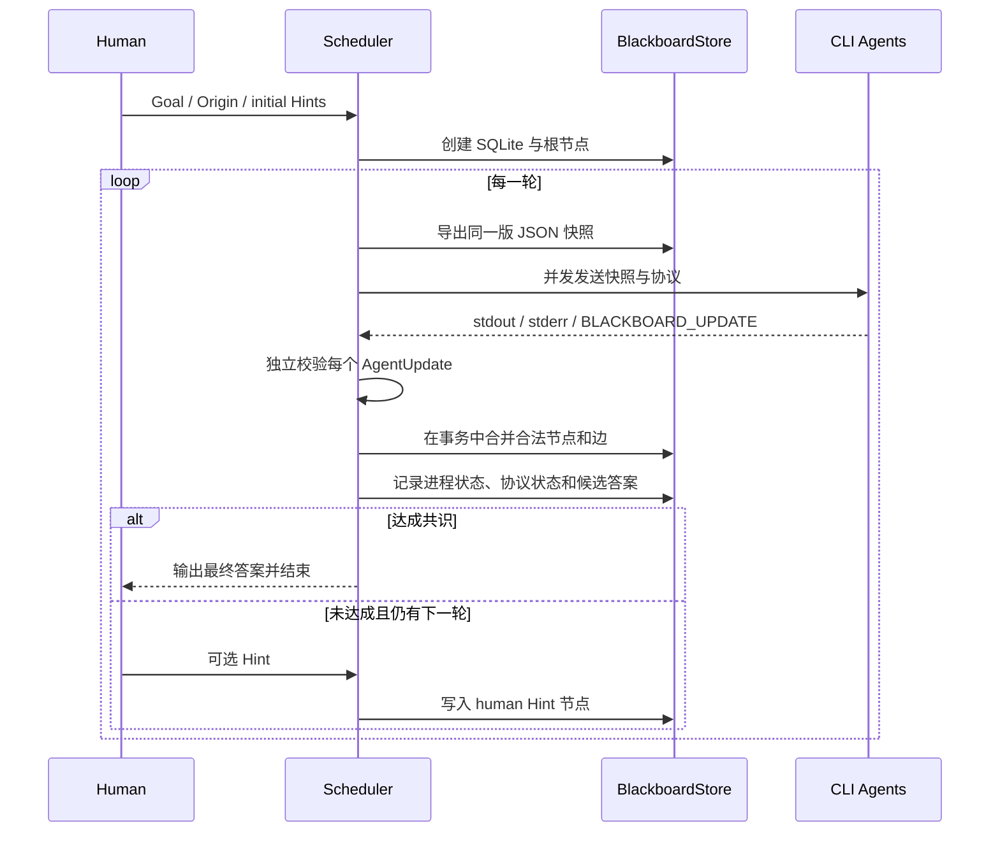

# Chinese Project README Implementation Plan

> **For agentic workers:** REQUIRED SUB-SKILL: Use superpowers:subagent-driven-development (recommended) or superpowers:executing-plans to implement this plan task-by-task. Steps use checkbox (`- [ ]`) syntax for tracking.

**Goal:** Replace the short English README with a detailed Chinese project document that accurately explains the design, implementation, innovations, Cairn lineage, usage, protocol, persistence, testing, limitations, and future direction.

**Architecture:** Keep documentation in the single root `README.md`, organized from project motivation and attribution through architecture and internals to operations and limitations. Validate the document with a repeatable PowerShell content audit and the existing Python regression suite.

**Tech Stack:** GitHub-Flavored Markdown, Mermaid, PowerShell validation, Python `unittest`.

---

## File Map

- Modify `README.md`: complete Chinese project documentation.
- Reference `docs/superpowers/specs/2026-07-12-chinese-readme-design.md`: approved content and attribution constraints.
- Reference `main.py`: current CLI flags and output behavior.
- Reference `orchestrator/models.py`: graph and result terminology.
- Reference `orchestrator/store.py`: SQLite tables, provenance, Fact consolidation, events, and snapshots.
- Reference `orchestrator/protocol.py`: request and `BLACKBOARD_UPDATE` contract.
- Reference `orchestrator/scheduler.py`: round execution, Hint collection, conflicts, and consensus.
- Reference `worker/providers.json`: provider configuration examples.

### Task 1: Establish the README Content Contract

**Files:**
- Inspect: `README.md`
- Inspect: `docs/superpowers/specs/2026-07-12-chinese-readme-design.md`

- [ ] **Step 1: Run the documentation audit against the current README**

Run:

```powershell
$content = Get-Content -Raw README.md
$required = @(
  '# 多 CLI CTF 黑板协作系统',
  '## 项目来源与致谢',
  'https://github.com/oritera/Cairn',
  '## 核心设计理念',
  '## 系统架构',
  '## 图黑板设计',
  '## SQLite 持久化设计',
  '## 项目创新点',
  'BLACKBOARD_UPDATE:',
  '--goal',
  '--origin',
  '--max-rounds',
  '## 当前限制'
)
$missing = $required | Where-Object { -not $content.Contains($_) }
if ($missing) {
  $missing | ForEach-Object { Write-Error "README missing: $_" }
  exit 1
}
```

Expected: exit code 1 with multiple `README missing` messages because the current README is the short English version.

- [ ] **Step 2: Confirm factual source material before writing**

Read these files completely:

```powershell
Get-Content -Raw docs\superpowers\specs\2026-07-12-chinese-readme-design.md
Get-Content -Raw main.py
Get-Content -Raw orchestrator\models.py
Get-Content -Raw orchestrator\protocol.py
Get-Content -Raw orchestrator\scheduler.py
Get-Content -Raw worker\providers.json
```

Expected: the sources confirm explicit Goal/Origin input, sourced graph nodes and edges, SQLite persistence, concurrent rounds, repeatable Hints, structured stdout, conservative Fact consolidation, and consensus that does not use provider priority.

### Task 2: Rewrite and Verify the Chinese README

**Files:**
- Modify: `README.md`

- [ ] **Step 1: Replace README.md with the complete Chinese document**

Use this exact content as the initial rewrite:

````markdown
# 多 CLI CTF 黑板协作系统

一个面向 CTF、安全研究与开放式问题求解的轻量级多 Agent 协作框架。项目通过黑板架构组织 Codex CLI、Claude Code、Kimi CLI 等命令行 Agent，让它们围绕同一个 `Origin` 和 `Goal` 分轮并发探索，并把发现、意图和人类提示沉淀为可追溯的图。

本项目不是把多个模型同时启动后简单收集答案，而是尝试解决多 Agent 系统中的三个核心问题：

- 不同 Agent 之间如何共享已经发现的信息，而不是形成信息孤岛。
- 如何保留事实、意图、提示和最终答案的来源，避免“结论来自哪里”不可追踪。
- 如何处理重复事实、相似事实、冲突结论和多个候选答案，而不是依赖固定模型优先级拍板。

## 项目来源与致谢

本项目的核心协作思想学习自 [oritera/Cairn](https://github.com/oritera/Cairn)。Cairn 将问题抽象为从 `Origin` 到 `Goal` 的未知状态空间搜索，并通过黑板架构维护 `Fact / Intent / Hint` 图。经与 Cairn 作者沟通并获得允许后，我基于对这些设计思想的学习，结合多 CLI Agent 与 CTF 场景进行了独立设计和实现。

本项目没有复制 Cairn 的源码，也不是 Cairn 的分支、兼容实现或官方项目。Cairn 使用 Server、Dispatcher、Worker Container 和 OODA 式任务调度，面向通用状态空间搜索；本项目目前采用 Python 单机调度、SQLite 图黑板、按轮并发 CLI Agent、结构化 stdout 协议和人类 Hint 交互，重点探索轻量级多 Agent CTF 协作。

感谢 Cairn 作者对这一方向的探索，以及对本项目学习和实践的支持。本项目与 Cairn 不存在官方隶属或背书关系。Cairn README 标明其项目采用 GNU AGPLv3；本项目对 Cairn 的说明仅用于陈述思想来源与学习背景，不将作者允许扩大解释为许可证豁免、商业授权或官方认可。

### 与 Cairn 的关系

| 维度 | Cairn | 本项目 |
| --- | --- | --- |
| 核心问题 | 从 Origin 到 Goal 的通用状态空间搜索 | 面向 CTF 和本地 CLI Agent 的轻量级协作 |
| 共同思想 | 黑板架构、Fact-Intent 图、Hint、人类与 Agent 协作 | 学习并保留这些核心抽象 |
| 运行形态 | Server + Dispatcher + Worker Container | 单机 Python CLI + 本地子进程 |
| 调度方式 | Bootstrap / Reason / Explore，OODA 循环 | 所有启用 Agent 按轮读取同一快照并发执行 |
| 持久化 | Cairn Server 管理项目状态 | 每次运行独立的 SQLite 数据库与 JSON 快照 |
| Worker 隔离 | Docker Worker Container | 独立工作目录和 CLI 自身沙箱能力 |
| 输出协议 | Dispatcher 管理 Worker 协议 | stdout 末尾的 `BLACKBOARD_UPDATE` JSON |
| 实现关系 | 原始项目 | 独立代码与独立架构，不复制 Cairn 源码 |

## 为什么需要黑板架构

传统的多模型并发通常采用广播式流程：把同一个题目发给多个 Agent，等待它们分别完成，然后由人类阅读多个答案。这种方式可以增加尝试数量，但每个 Agent 仍然在独立上下文中工作：

- Agent B 不知道 Agent A 已经确认了什么。
- 同一条事实会被多次分析和重复写入上下文。
- 冲突结论缺少显式关系，难以定位分歧来源。
- Agent 声称“已经完成”时，系统缺少跨来源验证。
- 人类只能在运行前写 prompt，难以在中途注入判断。

黑板架构把共享状态放到所有 Agent 之外。Agent 不直接互相通信，而是读取同一份黑板快照，并把结构化更新交给调度器。调度器是黑板的唯一写入者，负责来源赋值、格式校验、事务合并和冲突保留。

## 核心设计理念

### 1. 问题表示与执行工具分离

`orchestrator` 负责理解 Goal、Origin、Fact、Intent、Hint、图关系和共识；`worker` 只负责加载 CLI 配置并安全执行一次子进程。底层 CLI 不需要知道 SQLite 结构，调度器也不依赖某个特定模型 SDK。

### 2. 同轮一致快照

每轮开始时，调度器从 SQLite 导出一份不可变 JSON 快照。所有启用 Agent 都读取这一版状态并发执行，整轮结束后再统一合并，避免某个 Agent 在同轮内看到部分更新而另一个 Agent 看不到。

### 3. 来源优先于“看起来正确”

所有节点和边都记录来源与轮次。系统不根据 provider 名称或手工 priority 判断谁更可信。相互冲突的事实可以同时存在，后续 Agent 能沿着关系和来源继续验证。

### 4. 人类参与是协议的一部分

Hint 不是额外拼接到 prompt 末尾的临时文字，而是来源为 `human` 的正式图节点。交互运行时，人类可以在轮次之间追加 Hint；下一轮所有 Agent 都能看到它。

### 5. 保守合并

完全规范化一致的 Fact 会合并为一个命题节点，并保留多个来源。仅仅“文字相似”的事实不会强制合并，而是通过 `similar_to` 表达可能关联，避免把 `AES-CBC` 和 `AES-ECB` 这类相似但含义不同的结论误合并。

## 核心概念

| 概念 | 含义 | 谁可以创建 | 是否可修改 |
| --- | --- | --- | --- |
| `Goal` | 本次运行最终要实现的目标 | 人类输入路径 | 创建后不可由 Agent 修改 |
| `Origin` | 题面、初始条件和已知上下文 | 人类输入路径 | 创建后不可由 Agent 修改 |
| `Fact` | Agent 发现或声称成立的事实命题 | Agent | 节点不可覆盖，可增加来源和关系 |
| `Intent` | 某个 Agent 下一步准备探索的方向 | Agent | 新 Intent 会替代该 Agent 的旧 Intent |
| `Hint` | 人类在开始前或轮次之间提供的判断 | 人类输入路径 | 追加保存，不允许 Agent 伪造 |

这些概念都以图节点保存。系统不会把 Fact 自动视为绝对真理；Fact 的可信度来自来源、关系、后续验证和多个 Agent 的独立支持。

## 系统架构



### 目录结构

```text
main.py
orchestrator/
  __init__.py
  models.py
  protocol.py
  scheduler.py
  store.py
worker/
  __init__.py
  config.py
  executor.py
  models.py
  providers.json
  runs/
tests/
docs/superpowers/
```

### 模块职责

| 模块 | 职责 |
| --- | --- |
| `main.py` | 解析 CLI 参数、校验 Goal/Origin/challenge、启动调度器并展示结果 |
| `orchestrator/models.py` | 定义节点提案、边提案、AgentUpdate、协议结果和运行结果 |
| `orchestrator/store.py` | SQLite schema、图查询、来源记录、事务合并、Fact 去重、快照和事件 |
| `orchestrator/protocol.py` | 将图快照渲染为 Agent 请求，解析并校验 `BLACKBOARD_UPDATE` |
| `orchestrator/scheduler.py` | 创建运行目录、并发执行轮次、收集 Hint、处理冲突和判断共识 |
| `worker/config.py` | 加载和严格校验 provider JSON 配置 |
| `worker/executor.py` | 使用 `shell=False` 执行单个 CLI、处理超时、保存 stdout/stderr |
| `worker/providers.json` | 配置 provider 命令、启用状态、priority 元数据和超时 |

## 图黑板设计

### 节点

节点包含以下核心信息：

```json
{
  "id": "fact-...",
  "type": "fact",
  "content": "程序使用 AES-CBC",
  "state": "active",
  "created_round": 1,
  "sources": ["codex", "claude"]
}
```

Agent 不能指定最终 ID、来源和轮次。这些字段由调度器在合并时赋值，防止 Agent 伪造 `human` 来源或冒充其他 provider。

### 来源记录

合并后的 Fact 可能由多个 Agent 独立发现，因此来源不是节点上的单一字符串。SQLite 使用独立的 `node_provenance` 表保存：

- 节点 ID。
- 来源 Agent 或 `human`。
- 首次或再次提交该内容的轮次。
- Agent 原始提交的未规范化文本。

快照中的 `sources` 是从来源记录聚合得到的展示结果。

### 边

| 关系 | 含义 |
| --- | --- |
| `supports` | 一个节点为另一个结论提供支持 |
| `contradicts` | 两个事实或结论相互冲突 |
| `derived_from` | 当前发现来源于某个事实、提示或条件 |
| `addresses` | Hint 或探索方向针对某个 Goal/问题 |
| `plans_from` | Intent 基于某个现有节点产生 |
| `supersedes` | 新 Intent 替代同一 Agent 的旧 Intent |
| `similar_to` | 两个事实文本高度相似，但尚未确认等价 |
| `equivalent_to` | Agent 明确声明两个节点语义等价 |

边同样记录来源和轮次，并受 SQLite 外键约束，不能指向不存在的节点。

## SQLite 持久化设计

每次运行创建一个独立的 `blackboard.db`。主要逻辑表包括：

| 表 | 内容 |
| --- | --- |
| `runs` | 运行状态、最大轮次和最终答案 |
| `rounds` | 每轮状态及 JSON 快照路径 |
| `nodes` | Goal、Origin、Fact、Intent、Hint 图节点 |
| `node_provenance` | 节点来源、轮次和原始内容 |
| `edges` | 带来源的有向图关系 |
| `agent_results` | provider 进程状态、协议状态、日志路径和答案声明 |
| `events` | 节点创建、来源追加、边创建、Intent 替代和运行结束事件 |

### 为什么不是只用 JSON

JSON 适合作为 Agent 输入和人工检查，但不适合作为唯一可信状态：

- 每轮需要同时维护节点、边、来源和执行结果。
- 整轮合并需要原子提交和失败回滚。
- 图关系需要外键，避免悬空边。
- Fact 去重和来源聚合需要索引查询。
- 数据增长后不应每次重写完整历史。

因此 SQLite 是唯一可信数据源，JSON 只是每轮开始时导出的只读快照。SQLite 属于 Python 标准库，不需要额外部署数据库服务。

### 为什么不是专用图数据库

当前系统是单机 CLI 工具，一个调度器负责一个运行目录。Neo4j 等图数据库会引入服务部署、认证和运维成本，而当前规模使用 SQLite 的节点表、边表和索引已经足够。未来出现跨机器、多项目共享图或复杂图查询需求时，再考虑替换存储后端。

## 多轮执行流程



同一轮内的 Agent 互相看不到本轮的部分更新。它们都基于轮首快照独立工作，整轮完成后统一合并。这种方式保留并发性，也避免共享文件并发写入和读取时序差异。

## Fact 去重与相似性处理

### 完全一致的 Fact

Fact 在计算指纹前进行：

1. Unicode NFKC 规范化。
2. 清理首尾空白。
3. 折叠连续内部空白。

系统保留大小写和有意义的标点，因为 flag、哈希、路径、算法名称和标识符可能区分大小写。指纹相同的 Fact 使用同一个节点，并追加来源记录。

### 只是相似的 Fact

高文本相似度只会创建 `similar_to` 边，不会自动合并。这个设计是有意保守的：安全分析中一个字符差异就可能表示完全不同的算法、端口、偏移或密钥。

### 冲突的 Fact

调度器不会擅自删除其中一个结论。Agent 可以创建 `contradicts` 边，后续轮次继续验证。来源和原始文本始终保留在数据库中。

## 最终答案与共识

provider 的 `priority` 不能代表正确率。不同模型在 Web、Pwn、逆向、密码和取证题上的能力分布不同，模型版本和 CLI 配置也可能变化。因此本项目中 priority 只保留为 provider 配置元数据，不参与事实合并或最终答案选择。

当前共识规则：

- 多个 Agent 实际可用时，至少两个独立 provider 在同一轮提交相同最终答案，运行状态才变为 `achieved`。
- 只有一个 Agent 实际可用时，允许该 Agent 单独完成。
- 多个 Agent 给出冲突答案时，所有候选都会保存，并进入下一轮快照。
- 达到最大轮次仍有多个候选时，状态为 `unresolved`，不会按 priority 强行选择。
- 只有 `achieved` 返回退出码 `0`；未解决、轮次耗尽或没有可用 provider 返回 `1`。

## 项目创新点

### 1. 将多 CLI Agent 从“并发答题”升级为共享状态协作

Codex、Claude Code 和 Kimi 不再只是分别输出一份答案，而是在多个轮次中读取同一事实图，利用其他 Agent 已经沉淀的发现继续推进。

### 2. 命题与来源分离

Fact 节点表示规范化后的命题，`node_provenance` 表示谁在何时以什么原始文本提交了它。这样既减少重复 token，又不会因合并而丢失独立来源。

### 3. 图式表达冲突和探索方向

系统不仅保存文本列表，还保存 `supports`、`contradicts`、`derived_from`、`plans_from` 等关系。Agent 可以理解一个结论为什么出现、与哪些事实冲突，以及下一步 Intent 建立在哪些节点上。

### 4. 保守的相似性策略

许多系统为了压缩上下文会直接合并相似文本。本项目只自动合并规范化后完全一致的 Fact，相似内容仅关联不覆盖，以降低安全领域中的语义误判风险。

### 5. 人类 Hint 是一等图节点

人类可以在运行开始前和轮次之间加入判断，Hint 会被正式记录、标记为 human 来源，并由下一轮全部 Agent 读取。

### 6. 协议层与执行层解耦

`worker.executor` 不理解黑板语义，只执行请求和保存日志；`orchestrator.protocol` 负责提示与结构化输出。未来增加新的 CLI provider 时，不需要修改图存储和共识逻辑。

### 7. 使用标准库实现可审计的本地运行

核心运行时不依赖外部数据库或 Python 第三方包。每次运行都产生独立 SQLite、JSON 快照和原始日志，便于复盘 Agent 的判断过程。

## 环境要求

- Python 3.10 或更高版本。
- 至少安装并完成认证的一个 CLI Agent。
- Windows、macOS 或 Linux；不同 CLI 的参数可能随版本变化。

项目运行时只使用 Python 标准库。模型认证由各 CLI 自己管理，调度器不读取或保存 API Key。

## Provider 配置

默认配置位于 `worker/providers.json`：

```json
{
  "providers": [
    {
      "name": "codex",
      "enabled": true,
      "priority": 100,
      "command": ["codex", "exec", "-C", "{work_dir}", "-"],
      "timeout_seconds": 900
    }
  ]
}
```

字段说明：

| 字段 | 含义 |
| --- | --- |
| `name` | provider 名称，同时用作运行目录名，只允许安全字符 |
| `enabled` | 是否参与每轮执行 |
| `priority` | 保留的配置元数据，不参与事实或最终答案可信度判断 |
| `command` | 使用参数数组定义的 CLI 命令，不经过 shell 解释 |
| `timeout_seconds` | 单次调用超时时间，必须大于 0 |

支持的路径占位符：

- `{work_dir}`：当前 provider 在当前轮次的独立工作目录。
- `{challenge_dir}`：用户传入的题目目录；未提供时替换为空字符串。

prompt 不会插入命令参数，而是通过 stdin 发送，避免 PowerShell、cmd 或 POSIX shell 元字符被解释。

## 使用方法

### 提供 Goal、Origin 和题目目录

```powershell
python main.py --goal "找出最终 flag" --origin "分析题目目录中的二进制文件与 config.dat" --challenge E:\ctf\challenge
```

### 添加初始 Hint

`--hint` 可以重复使用：

```powershell
python main.py --goal "找出最终 flag" --origin "题面和已知条件" --hint "优先检查配置文件" --hint "关注 IV 是否复用" --challenge E:\ctf\challenge
```

### 设置最大轮次

```powershell
python main.py --goal "找出最终 flag" --origin "题面和已知条件" --max-rounds 7
```

默认最多运行 5 轮。`--max-rounds` 必须为正整数。

### 交互输入

省略 `--goal` 或 `--origin` 时，CLI 会分别询问：

```text
Goal:
Origin:
```

在交互终端中，如果一轮结束后尚未达成共识且仍有剩余轮次，程序会询问：

```text
Hint (blank to continue):
```

直接回车进入下一轮，输入内容则创建新的 human Hint 节点。非交互环境会自动跳过轮间 Hint。

### 使用其他 provider 配置

```powershell
python main.py --config E:\ctf\providers.json --goal "找出 flag" --origin "题面"
```

## Agent 输出协议

Agent 可以在 stdout 中输出普通分析，但必须在末尾给出一行结构化更新：

```text
BLACKBOARD_UPDATE: {"nodes": [...], "edges": [...], "goal_achieved": false, "final_answer": null}
```

完整示例：

```text
我确认配置文件中的 16 字节字段被直接用作 IV，下一步需要验证密钥来源。
BLACKBOARD_UPDATE: {"nodes":[{"ref":"fact-iv","type":"fact","content":"config.dat 中的 16 字节字段被用作 AES-CBC IV"},{"ref":"intent-key","type":"intent","content":"追踪 AES 密钥的生成与加载路径"}],"edges":[{"type":"plans_from","from":"intent-key","to":"fact-iv"}],"goal_achieved":false,"final_answer":null}
```

协议约束：

- Agent 只能提出 `fact` 和 `intent` 节点。
- Agent 不能创建或修改 `goal`、`origin`、`hint`。
- Agent 不能提交 `source`、持久化 ID 或轮次。
- 边可以引用快照中的节点 ID，也可以引用本次更新中的临时 `ref`。
- `goal_achieved=true` 时必须提供非空 `final_answer`。
- 非法更新整份拒绝，不进行部分写入。
- 进程成功但没有合法协议时记录为 `protocol_error`，原始 stdout 仍然保留。

## 运行产物

每次调用创建独立目录：

```text
worker/runs/<run-id>/
  blackboard.db
  snapshots/
    round-000.json
    round-001.json
  rounds/
    001/
      codex/
        stdout.txt
        stderr.txt
      claude/
        stdout.txt
        stderr.txt
```

- `blackboard.db`：唯一可信状态，包含图、来源、事件和执行结果。
- `snapshots/round-NNN.json`：每轮开始时提供给 Agent 的只读图快照。
- `stdout.txt`：provider 的完整标准输出，包括普通分析和协议行。
- `stderr.txt`：provider 的错误与诊断信息。
- provider 工作目录：Agent 可以在其中写入反编译结果、脚本和其他产物。

CLI 完成后会输出运行状态、轮次数、最终答案或候选答案、运行目录和数据库路径。

## 状态与错误隔离

| 状态 | 含义 |
| --- | --- |
| `success` | 单个 CLI 进程以 0 退出 |
| `failed` | 单个 CLI 进程非 0 退出 |
| `timeout` | 单次 provider 调用超过配置时间 |
| `unavailable` | CLI 不存在或无法启动 |
| `protocol_error` | 进程成功，但结构化更新缺失或非法 |
| `achieved` | 最终答案满足当前共识规则 |
| `unresolved` | 存在多个冲突候选，达到轮次上限仍未解决 |
| `max_rounds_reached` | 轮次耗尽，未形成完成共识 |
| `no_usable_providers` | 没有启用或可启动的 provider |

一个 provider 的失败、超时、不可用或协议错误不会取消同轮其他 provider。合法更新会继续进入黑板。

## 测试与可靠性

运行全部测试：

```powershell
python -m unittest discover -s tests -v
```

当前回归套件包含 40 项测试，覆盖：

- provider 配置校验、重复名称、路径穿越和非法占位符。
- Windows CLI shim 解析、stdin 原样传输、超时、失败和不可用命令。
- SQLite schema、外键、来源、快照和事务回滚。
- Fact 去重、相似关系、Intent 替代和 Hint 来源。
- 协议解析、非法节点、伪造来源、未知边引用和完成声明。
- 同轮并发、快照一致性、冲突候选、Hint 传递和单 Agent 完成。
- CLI 参数、退出码、最终答案和 unresolved 候选展示。
- 两个本地 fake provider 的真实子进程 smoke 配置。

测试使用本地 Python fake CLI，不会调用真实模型，也不会消耗模型额度。

编译检查：

```powershell
python -m compileall main.py orchestrator worker tests
```

## 适用场景

- CTF 题目的多模型并行分析和多轮收敛。
- 需要保留来源与冲突关系的安全研究记录。
- 比较不同 CLI Agent 在同一状态快照上的判断。
- 研究黑板架构、stigmergy 和人机协作。
- 需要本地可审计运行产物的开放式问题探索。

本项目不仅能表达 CTF 问题，但当前实现和默认配置主要围绕 CTF 与安全分析验证。

## 安全与授权声明

本项目可用于 CTF、安全评估、漏洞研究和渗透测试相关任务，但只能在你明确拥有授权的环境中使用。不要对未经所有者许可的系统、网络、应用或数据运行自动化安全测试。

使用者需要自行确保行为符合所在地区的法律法规、合同义务和组织安全政策。项目作者不鼓励也不认可任何未授权访问、破坏、数据获取或滥用行为。

## 当前限制

- 这是单机进程调度，不是分布式任务系统。
- 工作目录隔离不等同于容器级安全隔离；实际权限仍取决于各 CLI 的沙箱参数。
- 当前没有 Web UI、HTTP API 或实时图可视化界面。
- 相似 Fact 只使用保守文本相似度建立关系，没有 embedding 或语义模型判定。
- 最终答案共识基于规范化后的精确文本，不会自动向 CTF 平台提交或验证 flag。
- 当前没有按题型统计 provider 历史准确率，因此不会把 priority 当作可信度。
- 一个运行目录只由一个调度器进程写入，不支持多个 orchestrator 共享写数据库。
- 不负责安装、登录或升级 Codex、Claude Code、Kimi 等第三方 CLI。

## 未来方向

- 为黑板增加只读 Web UI 和图可视化。
- 支持从数据库恢复中断的运行。
- 增加可插拔调度策略，而不局限于“每轮运行全部 Agent”。
- 引入显式的验证任务，让 Agent 对冲突 Fact 和候选答案进行专门复核。
- 支持更多本地或远程 CLI provider。
- 在保持来源可追溯的前提下压缩大型图快照。
- 抽象存储接口，为远程数据库或专用图存储保留替换空间。
- 增加按 CTF 题型统计的 provider 表现数据，但不把统计先验直接当作事实真值。

## 开发与扩展原则

扩展项目时建议保持以下边界：

- 新 CLI 接入优先修改 `worker/providers.json`，不要把 provider 特例写进 orchestrator。
- 新图关系需要同时更新模型常量、协议校验、存储约束和测试。
- 新调度策略应复用 `BlackboardStore` 与 `execute_provider`，避免让 Agent 直接写数据库。
- 新的 Fact 压缩策略必须保留来源，且不能把文本相似直接等同于语义等价。
- 任何完成策略都不应使用手工 priority 直接覆盖冲突证据。

## 致谢

再次感谢 [Cairn](https://github.com/oritera/Cairn) 作者对通用状态空间搜索、黑板架构和 Fact-Intent 图的公开探索，以及对本项目学习与独立实践的允许和支持。
````

- [ ] **Step 2: Re-run the documentation audit and verify it passes**

Run:

```powershell
$content = Get-Content -Raw README.md
$required = @(
  '# 多 CLI CTF 黑板协作系统',
  '## 项目来源与致谢',
  'https://github.com/oritera/Cairn',
  '## 核心设计理念',
  '## 系统架构',
  '## 图黑板设计',
  '## SQLite 持久化设计',
  '## 项目创新点',
  'BLACKBOARD_UPDATE:',
  '--goal',
  '--origin',
  '--max-rounds',
  '## 当前限制'
)
$forbidden = @('--prompt', 'worker.runner', 'RunSummary')
$missing = $required | Where-Object { -not $content.Contains($_) }
$stale = $forbidden | Where-Object { $content.Contains($_) }
if ($missing -or $stale) {
  $missing | ForEach-Object { Write-Error "README missing: $_" }
  $stale | ForEach-Object { Write-Error "README stale reference: $_" }
  exit 1
}
```

Expected: exit code 0 with no error output.

- [ ] **Step 3: Verify Markdown and Mermaid fences are balanced**

Run:

```powershell
$content = Get-Content -Raw README.md
$fences = ([regex]::Matches($content, '(?m)^```')).Count
$mermaidStarts = ([regex]::Matches($content, '(?m)^```mermaid$')).Count
if ($fences % 2 -ne 0) { Write-Error 'Unbalanced Markdown fences'; exit 1 }
if ($mermaidStarts -ne 2) { Write-Error "Expected 2 Mermaid diagrams, got $mermaidStarts"; exit 1 }
```

Expected: exit code 0 with exactly two Mermaid diagrams and balanced fences.

- [ ] **Step 4: Run the complete regression suite**

Run:

```powershell
python -m unittest discover -s tests -v
```

Expected: 40 tests pass and the command ends with `OK`.

- [ ] **Step 5: Review the final diff for attribution and implementation accuracy**

Run:

```powershell
git diff -- README.md
```

Verify the diff contains:

- A direct Cairn link and clear statement that the core concepts were learned from Cairn.
- The statement that the author allowed the learning and independent practice.
- A clear statement that no Cairn source code was copied and there is no official affiliation.
- A comparison table that distinguishes Cairn's Server/Dispatcher/Container architecture from this local SQLite implementation.
- Only features present in the current code under current capabilities.
- Server, Web UI, vector retrieval, distributed execution, and graph databases only under limitations or future direction.

- [ ] **Step 6: Commit the README rewrite**

```powershell
git add README.md docs/superpowers/plans/2026-07-12-chinese-readme.md
git commit -m "docs: expand Chinese project README"
```

Expected: one documentation commit containing the Chinese README and its implementation plan.
