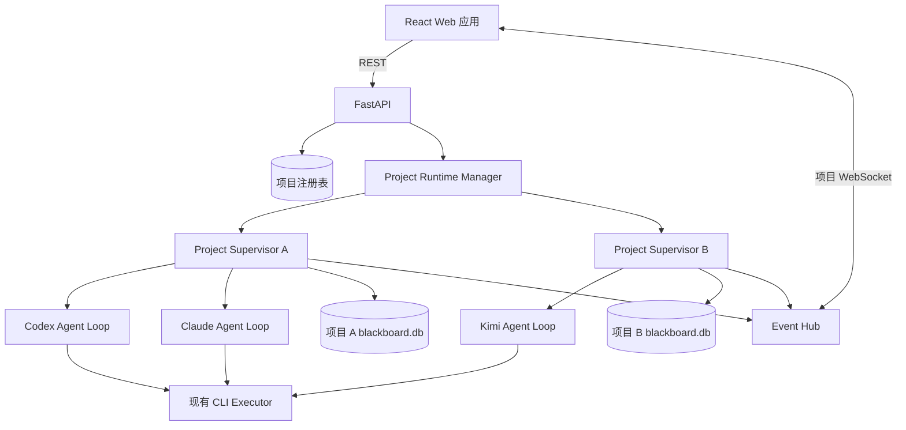

# Web 黑板可视化与异步多 Agent 设计

日期：2026-07-12

状态：设计已确认，等待实施计划

## 目标

为现有多 CLI 黑板编排器增加一个本机 Web 应用，使用户能够创建和同时运行多个相互隔离的项目，并以可编辑图的方式观察和管理协作过程。

每个项目同时代表一个黑板和一个任务。项目可以在创建时选择“仅黑板”或“立即启动 Agent”，仅黑板项目以后也能启动 Agent。一个项目内可以运行多个 Agent，不同项目也可以并发运行。

图中使用节点表示 `Goal`、`Origin`、`Fact` 和 `Hint`，使用第一类边表示 `Intent`。普通关系如 `supports`、`contradicts`、`derived_from` 和 `similar_to` 也继续使用边表示。用户可以拖动节点、调整边走线、重连边端点，并点击任何节点或边查看内容、来源、代际和执行信息。

点击最新 generation 的节点或运行中的 Intent 边时，页面必须显示对应 Agent 的真实 stdout/stderr 流、进程状态和工作目录。历史元素显示已保存日志，不伪装为实时状态。

## 非目标

- 第一版不提供登录、组织、项目共享或多用户并发编辑。
- 第一版只监听 `localhost`，不作为公网服务部署。
- 不在运行时把旧的 Intent 节点自动转换为 Intent 边。
- 不自动恢复服务重启前仍在运行的外部 CLI 进程。
- 不实现跨机器调度、容器集群或外部图数据库。

## 已确认的技术方案

- 前端：React、TypeScript、Vite、React Flow。
- 后端：FastAPI、WebSocket、现有 Python 编排模块。
- 项目图存储：每个项目独立 SQLite 数据库。
- 项目注册表：独立的全局 SQLite，只保存项目元数据和项目目录映射。
- 实时传输：REST 获取快照和执行命令，项目级 WebSocket 发送增量事件与日志。
- Agent 调度：同一项目内的多个 Agent 异步循环，不设全局轮次屏障。
- Intent 协议：两阶段调用，先规划并登记 Intent，再执行并提交结果。

## 总体架构



React 应用包含项目总览、黑板工作区、详情检查器和实时日志台。FastAPI 是现有 Python 编排器之上的 Web 适配层，不复制图合并或 CLI 执行逻辑。

`ProjectRuntimeManager` 为每个活动项目维护一个 `ProjectSupervisor`。Supervisor 拥有项目写队列、Agent 循环、进程组、取消令牌和事件发布器。一个项目内只存在一个 Supervisor，但 Supervisor 可以启动多个 Agent 循环。

## 项目隔离

项目目录由服务端根据不可猜测的 `project_id` 创建。客户端不能提交或修改项目数据库、日志目录或运行目录的绝对路径。

```text
web-data/
  projects.db
  projects/
    <project-id>/
      blackboard.db
      layout.json
      snapshots/
      executions/
        <execution-id>/
          stdout.txt
          stderr.txt
          work/
```

隔离规则：

- 每个项目使用独立 SQLite 文件和独立文件目录。
- 每个项目使用独立 Supervisor、写队列、取消令牌和 WebSocket 频道。
- 同一项目只允许一个活动 Supervisor，避免重复启动相同 Agent 集合。
- 不同项目可以同时运行，由全局并发信号量限制 CLI 总数。
- 所有日志、停止、恢复和详情请求同时校验 `project_id` 与 `execution_id`。
- 服务端解析后的任何项目内路径都必须仍位于该项目根目录下。
- challenge 目录是用户显式选择的只读外部路径，只传给对应项目的 Agent。

第一版无用户身份，但服务层接口始终显式接收 `project_id`。未来加入用户和权限时，可以在项目注册表与 API 依赖层增加所有权检查，而不改变项目数据库格式。

## 图领域模型

### 节点

允许的节点类型：

- `goal`：项目要实现的结果。
- `origin`：题面、初始条件和输入上下文。
- `fact`：Agent 或人类新增的事实命题。
- `hint`：人类提供的指导。

`intent` 从允许的节点类型中彻底移除。数据库、快照、Agent 协议、API 和前端都不能创建 Intent 节点。

节点包含：

- `id`
- `type`
- `content`
- `state`
- `generation`
- `created_at`
- 来源记录

初始 Goal、Origin 和 Hint 属于 generation 0。Fact 的 generation 由产生它的 Intent 决定。

### 边

边分为两类：

- Intent 边：表示一个 Agent 或人类准备从某个已知节点向目标节点推进的具体行动。
- 普通关系边：`supports`、`contradicts`、`derived_from`、`addresses`、`similar_to`、`equivalent_to` 等。

Intent 边必须包含：

- `from_node_id`
- `to_node_id`
- `content`
- `generation`
- 语义指纹
- 创建时间
- 来源记录

正常情况下，Agent 从 Fact 创建 Intent。项目尚无 Fact 时，Origin 可以作为 bootstrap Intent 的唯一非 Fact 来源。Intent 的目标通常是 Goal，也可以是需要验证、反驳或补全的 Fact 或 Hint。

Intent 的语义指纹由来源节点、目标节点和规范化内容组成。指纹相同的 Intent 共用一条图边，但不同 Agent 的实际运行分别保存在 `intent_executions` 中。因此图不会堆叠相同边，同时仍保留独立验证和独立日志。

### 图代际

系统保留“最新一轮”概念，但轮次定义为图的 `generation`，不是同步执行屏障。

- Goal、Origin 和初始 Hint 为 generation 0。
- 从 generation N 节点创建的 Intent 为 generation N+1。
- 该 Intent 产生的新 Fact 为 generation N+1。
- 页面中的“最新一轮”指当前图的最高 generation。
- 多个 Agent 可以同时在相同或不同 generation 工作。

该定义可以在完全异步执行下保留因果层次和最新活动筛选。

## SQLite 结构

现有 schema 需要迁移到下列职责边界。具体迁移脚本在实施计划中拆分。

### 项目注册表

`projects`：

- `id`
- `name`
- `mode`
- `status`
- `project_path`
- `challenge_path`
- `created_at`
- `updated_at`
- `last_opened_at`

注册表不保存图数据或 Agent 日志。

### 项目数据库

`nodes` 保存 Goal、Origin、Fact 和 Hint。节点类型约束不再接受 Intent。

`node_provenance` 保存来源、原始文本和创建时间。

`node_versions` 保存人类通过项目设置修改 Goal 或 Origin 时的旧内容、新内容、操作者和时间。

`edges` 保存端点、关系类型、generation 和创建时间。

`edge_provenance` 保存边的来源。

`intents` 以 `edge_id` 为主键，保存 Intent 内容、指纹和聚合状态。

`intent_executions` 保存：

- `id`
- `intent_edge_id`
- `agent_id`
- `provider`
- `status`
- `started_at`
- `finished_at`
- `exit_code`
- `stdout_path`
- `stderr_path`
- `work_dir`
- `error_message`

`intent_outputs` 保存 `intent_edge_id`、`execution_id` 和 `node_id`，明确记录每个新 Fact 由哪条 Intent 和哪次 Agent execution 产生。前端通过该表从最新 Fact 定位对应 Intent 与实时日志，不使用文本猜测。

`events` 保存项目内单调递增的 `sequence`、事件类型、关联实体和 JSON payload，用于 WebSocket 恢复与审计。

`final_answers` 保存 Agent 的完成声明、答案和对应的 Goal version。达到项目共识后状态变为 `achieved`。

布局不写入语义表。`layout.json` 单独保存 layout revision、节点坐标、边控制点和视口。写入时使用临时文件加原子替换，并在项目锁内完成。

## Agent 异步循环

每个启用的 provider 在项目 Supervisor 下运行一个独立循环：

1. 读取当前项目快照，包括节点、边、未分配的人工 Intent、活动 Intent、失败记录和最高 generation。
2. 如果存在可执行的未分配人工 Intent，系统在事务中把它分配给当前 Agent，并跳过规划调用。
3. 否则调用规划阶段，让 Agent 选择一个 Fact；无 Fact 时只允许选择 Origin。
4. Agent 输出计划或显式 idle 结果。
5. 系统校验端点、节点类型、内容和引用，并在事务中创建或复用 Intent 边。
6. 系统创建独立 `intent_execution`，状态从 `planned` 进入 `running`。
7. 调用执行阶段，将已确认的 Intent 和当前图上下文发送给 Agent。
8. stdout/stderr 分块保存到文件，并通过项目 WebSocket 转发。
9. Agent 输出 `BLACKBOARD_RESULT`。
10. 系统校验整个结果，并在一个事务中写入 Fact、`intent_outputs`、普通关系、答案声明和 execution 终态。
11. Agent 短暂退避后重新观察黑板；显式 idle 或没有可用工作时进入 idle，收到图更新事件后被唤醒。

Agent 对 Fact 的选择不是排他锁。同一个 Fact 可以被多个 Agent 以不同 Intent 探索；相同语义 Intent 会合并边，但保留各 Agent 的 execution。

## Agent 协议

### 规划阶段

Agent 可以输出普通文本，但最后必须输出：

```text
BLACKBOARD_INTENT: {"action":"plan","source_node_id":"fact-...","target_node_id":"goal-...","content":"验证配置文件是否泄露 JWT 密钥"}
```

没有合理工作时，Agent 必须显式返回：

```text
BLACKBOARD_INTENT: {"action":"idle","reason":"当前 Fact 已有充分验证且没有未解决冲突"}
```

约束：

- Agent 不能提供持久化 edge id、来源、generation、状态或时间。
- `action` 只能是 `plan` 或 `idle`。
- `action=plan` 时，`source_node_id` 必须是现有 Fact；没有 Fact 时可以是 Origin。
- `action=plan` 时，`target_node_id` 必须是现有 Goal、Fact 或 Hint，content 必须非空。
- `action=idle` 时必须提供非空 reason，且不能同时提供端点或 content。
- 非法规划不会创建部分 Intent。

### 执行阶段

Agent 可以输出普通分析，但最后必须输出：

```text
BLACKBOARD_RESULT: {"intent_id":"intent-...","facts":[...],"edges":[...],"goal_achieved":false,"final_answer":null}
```

约束：

- Agent 只能创建 Fact 节点和普通关系边。
- Agent 不能在结果阶段创建新的 Intent；下一次循环重新进入规划阶段。
- Agent 不能创建或修改 Goal、Origin 或 Hint。
- `intent_id` 必须等于系统为本次 execution 分配的 Intent。
- 所有引用必须指向现有节点或本次结果中的临时 Fact ref。
- `goal_achieved=true` 时必须提供非空最终答案。
- 结果整份校验，失败时不进行部分写入。

## 项目状态与停止条件

项目状态：

- `idle`：项目存在但没有活动 Agent execution。
- `running`：至少一个 execution 正在运行。
- `degraded`：仍可运行，但一个或多个 Agent 连续失败或不可用。
- `achieved`：最终答案满足共识规则。
- `stopped`：用户主动停止。

单个 execution 状态：

- `planned`
- `running`
- `completed`
- `failed`
- `cancelled`
- `interrupted`

Agent 在以下情况停止或进入 idle：

- 项目达到 Goal。
- 用户停止项目。
- 该 Agent 连续失败达到配置阈值。
- 当前没有可探索节点或有效 Intent。
- 全局并发限制暂时没有可用槽位。

同一 Intent 边的展示状态按 execution 聚合：存在 planned 或 running execution 时为 `running`；没有活动 execution 且至少一个 completed 时为 `completed`；所有 execution 均 cancelled 时为 `cancelled`；其他全部失败或中断时为 `failed`。

用户停止项目时，后端终止该项目 Supervisor 管理的全部 CLI 进程树。不得影响其他项目进程。

服务重启时，数据库中未完成的 execution 标记为 `interrupted`。外部 CLI 不自动恢复；用户可以重新启动项目。

### 异步共识

多个可用 provider 参与项目时，两个独立 provider 在任意时间提交规范化后相同的最终答案，项目即达到 `achieved`。只有一个可用 provider 时，允许该 provider 单独完成。冲突答案全部保留，Agent 可以继续围绕冲突 Fact 和 Intent 探索。Goal 内容被人类修改后，旧答案声明不参与新 Goal 版本的共识。

## Web API

第一版 API 至少包含：

- `GET /api/projects`
- `POST /api/projects`
- `GET /api/projects/{project_id}`
- `PATCH /api/projects/{project_id}`
- `POST /api/projects/{project_id}/start`
- `POST /api/projects/{project_id}/stop`
- `GET /api/projects/{project_id}/graph`
- `POST /api/projects/{project_id}/nodes`
- `PATCH /api/projects/{project_id}/nodes/{node_id}`
- `DELETE /api/projects/{project_id}/nodes/{node_id}`
- `POST /api/projects/{project_id}/edges`
- `PATCH /api/projects/{project_id}/edges/{edge_id}`
- `DELETE /api/projects/{project_id}/edges/{edge_id}`
- `PUT /api/projects/{project_id}/layout`
- `GET /api/projects/{project_id}/executions/{execution_id}`
- `GET /api/projects/{project_id}/executions/{execution_id}/logs`
- `WS /ws/projects/{project_id}`

项目创建请求包含名称、Goal、Origin、初始 Hint、模式、启用的 provider、项目 Agent 上限和可选 challenge 目录。

仅黑板项目初始化图后保持 idle。立即启动模式在创建成功后启动 Supervisor。仅黑板项目以后调用 start 使用同一图继续运行。

## WebSocket 事件

事件至少包括：

- `project.status_changed`
- `agent.status_changed`
- `graph.node_added`
- `graph.node_updated`
- `graph.edge_added`
- `graph.edge_updated`
- `intent.execution_started`
- `intent.log_chunk`
- `intent.execution_finished`
- `answer.proposed`

每个事件包含 `project_id`、单调递增的 `sequence`、时间和 payload。页面先通过 REST 获取包含当前 sequence 的完整快照，再订阅 WebSocket。

断线重连时，如果收到的 sequence 与本地期望值不连续，前端必须重新获取完整快照，不能猜测或补造缺失状态。

## 人工编辑与审计

浏览模式允许选择、平移、缩放、筛选和查看详情。编辑模式才允许创建或归档节点、创建关系或 Intent、拖动 Intent 端点和调整边控制点。

节点位置和边控制点只改变布局文件，不改变图语义或来源。

人工语义编辑遵循以下规则：

- 人类可以新增 Fact、Hint、普通关系和 Intent。
- 人工新增内容记录 `human` 来源。
- Agent 产生的节点和边不能被直接改写文本；人类可以归档、添加 contradicts 边或新增替代内容。
- Goal 和 Origin 只能通过项目设置修改，修改记录版本事件。
- 删除采用归档状态，不物理删除有来源或执行记录的历史元素。
- 人工 Intent 可以保持未分配状态，也可以在启动项目时由 Agent 执行。

## 前端页面

### 项目总览

首页直接展示项目总览，不设置营销落地页。

项目卡显示：

- 项目名称和状态。
- Goal 摘要。
- Fact、Intent 和最高 generation 数量。
- 正在运行或失败的 Agent。
- 最近活动时间。

总览支持按全部、运行中、仅黑板、已完成筛选，支持搜索和新建项目。

### 新建项目

新建对话框包含：

- 项目名称。
- Goal。
- Origin。
- 可重复的初始 Hint。
- challenge 目录。
- “仅黑板”或“立即启动 Agent”模式。
- provider 多选。
- 项目最大并发 Agent 数。

### 黑板工作区

工作区采用全屏工具布局：

- 顶部：返回总览、项目名称、项目状态、generation 筛选、浏览/编辑模式、启动或停止。
- 左侧：选择、添加节点、连接、适应画布等图工具。
- 中央：React Flow 图画布。
- 右侧：节点或边详情检查器。
- 底部：可折叠实时日志台。

不同节点类型使用不同但克制的颜色和形状标识。Intent 边根据 execution 聚合状态显示为 planned、running、completed、failed 或 cancelled。运行中的 Intent 具有明确但不干扰阅读的运动或流向提示。

选择任何节点或边都打开右侧详情。选择最新 generation 的 Fact 时，页面自动定位产生它的 Intent。选择 Intent 时，详情按 Agent execution 分标签；运行中的 execution 自动订阅实时日志，历史 execution 加载保存的 stdout/stderr。

窄屏下，项目总览保持可用；黑板详情和日志改为抽屉或底部面板。画布仍可平移缩放，编辑工具不能与详情面板重叠。

## 错误处理与恢复

- 规划协议错误不会创建 Intent。
- 执行协议错误不会写入部分 Fact 或边。
- 原始 stdout/stderr 始终保留。
- 单个 Agent 的失败、超时或不可用不阻塞其他 Agent。
- 一个项目的数据库或进程错误不改变其他项目状态。
- SQLite 启用 WAL 和 busy timeout，所有写入经过项目写队列与事务。
- 布局写入使用 revision 和原子文件替换。
- WebSocket 事件缺口通过完整快照恢复。
- 项目目录和日志路径进行越界校验。
- 全局并发信号量限制 CLI 总数，避免多个项目耗尽本机资源。
- Agent 连续失败达到阈值后暂停该 Agent，并把项目标记为 degraded。

默认连续失败阈值为 3，可在服务配置中修改。成功完成一次 execution 后，该 Agent 的连续失败计数清零。

## 测试策略

### 后端单元测试

- Intent 只能作为边存在。
- generation 计算与 bootstrap Origin 规则。
- Intent 指纹合并和独立 execution 保留。
- Fact 去重、来源聚合和事务回滚。
- 人工编辑审计与归档。
- 项目路径和 execution 路径隔离。

### 协议测试

- 合法 `BLACKBOARD_INTENT` 和 `BLACKBOARD_RESULT`。
- 非法节点引用、空内容和伪造系统字段。
- Result 引用错误 Intent。
- 缺失结构化尾行、部分 JSON 和额外垃圾内容。
- Agent 超时、非零退出和取消。

### 运行时集成测试

使用本地 fake CLI，不消耗模型额度：

- 一个项目多个 Agent 异步运行。
- 两个项目同时运行且数据库、日志和事件不串线。
- stdout/stderr 分块实时发送。
- 单 Agent 失败不阻塞其他 Agent。
- 停止项目只终止该项目进程树。
- 服务重启把运行中 execution 标记为 interrupted。

### API 与 WebSocket 测试

- 项目创建、列表、详情、启动和停止。
- 仅黑板项目以后启动 Agent。
- 图 CRUD 与人工来源。
- layout revision 冲突。
- WebSocket sequence 连续性和断线恢复。
- project_id 与 execution_id 不匹配时拒绝访问。

### 前端测试

- 项目筛选、搜索和创建表单。
- 浏览/编辑模式权限。
- 节点拖动、Intent 端点重连和走线控制点。
- 节点与边详情。
- 多 execution 标签和日志切换。
- latest generation 高亮。
- WebSocket 重连后的完整快照恢复。

### 端到端与视觉验证

Playwright 使用 fake providers 验证：

- 同时启动两个项目并观察独立更新。
- 创建纯黑板、人工添加 Fact 和 Intent，再启动 Agent。
- 点击最新 Fact 定位 Intent 并查看真实日志流。
- 停止一个项目后另一个项目继续运行。
- 桌面和窄屏视口无文本溢出、遮挡或空白画布。

## 验收标准

以下条件全部满足时功能完成：

1. 用户可以创建仅黑板或立即运行的项目。
2. 项目总览可以同时展示多个项目的独立状态。
3. 同一项目能启动多个 Agent 异步循环。
4. Agent 先创建 Intent 边，再执行并提交 Fact。
5. 数据库和协议中不存在新建 Intent 节点的路径。
6. 不同项目的数据库、进程、日志和 WebSocket 事件不会串线。
7. 节点和边可选择、拖动或重连，并能查看完整来源和执行详情。
8. 点击最新 generation 元素可以看到对应 Agent 的实时工作日志。
9. 单个 Agent 或单个项目失败不影响其他 Agent 或项目。
10. 自动化测试和 Playwright 端到端验证通过。

## 现有代码迁移边界

现有 `orchestrator.models`、`orchestrator.protocol`、`orchestrator.store`、`orchestrator.scheduler` 和 `worker.executor` 将被逐步修改，而不是在旁边保留第二套图模型。

旧的 Intent 节点 schema 不进入新 Web 运行时。已有 `worker/runs` 保持原样，不自动导入或转换。CLI 入口最终也应使用新的 Intent 边协议，确保 Web 与 CLI 只有一套领域模型。

实施计划必须先完成存储和协议迁移，再实现异步 Supervisor 和 Web API，最后实现 React UI 与端到端测试，避免前端依赖尚未稳定的数据契约。
